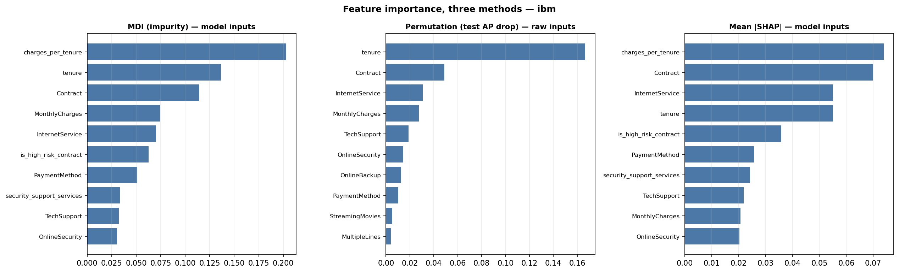
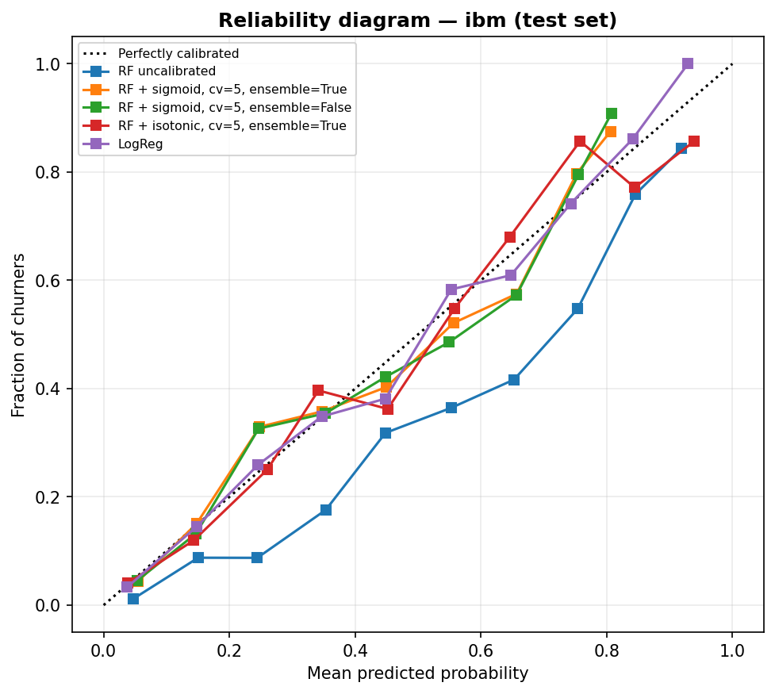

# 5.2. Phân tích Random Forest và ablation

> Bản nháp — Nam Khánh. Số liệu lấy từ `reports/results_snapshot.md` của lần chạy đầy đủ tại commit
> `341ea0a` (§ = mục trong snapshot); sẽ cập nhật theo tag `v1.0-results`. Hình trong `figures/rf/`,
> notebook minh họa `notebooks/02_random_forest_analysis.ipynb`.

## 5.2.1. Cấu hình Random Forest sau khi tune

| Dataset | `n_estimators` | `max_depth` | Ghi chú |
|---|---:|---:|---|
| IBM Telco | 500 | 10 | Dữ liệu nhiễu, giới hạn độ sâu có lợi |
| Iranian Churn | 200 | không giới hạn | Tune với CV chia theo nhóm (dòng trùng không tách fold) |
| Orange Telecom | 500 | không giới hạn | |

Các tham số khác lấy từ lưới ở mục 4.2.5; `class_weight="balanced_subsample"` cố định (xem 5.2.7).

## 5.2.2. Random Forest so với mô hình mạnh nhất còn lại (10 lần chia dữ liệu)

Mỗi mô hình được huấn luyện lại trên 10 lần chia 70/15/15 với 10 seed khác nhau (tham số tune cố định),
đánh giá trên tập test ở ngưỡng 0.5 (§7). Đối thủ mạnh nhất (AP trung bình cao nhất) hiện là LogReg;
DT, KNN, SVM sẽ được bổ sung ở mục 5.1.

| Dataset | AP — RF | AP — LogReg | p (Wilcoxon, AP) | F1 — RF | F1 — LogReg | p (Wilcoxon, F1) |
|---|---:|---:|---:|---:|---:|---:|
| IBM | 0.665 ± 0.019 | 0.668 ± 0.015 | 0.19 | 0.629 ± 0.013 | 0.578 ± 0.017 | 0.002 |
| Orange | 0.835 ± 0.047 | 0.465 ± 0.059 | 0.002 | 0.755 ± 0.037 | 0.266 ± 0.071 | 0.002 |
| Iranian | 0.912 ± 0.021 | 0.769 ± 0.029 | 0.002 | 0.863 ± 0.030 | 0.577 ± 0.034 | 0.002 |

- **IBM:** khả năng xếp hạng của RF và LogReg **ngang nhau** (chênh AP −0.004, p = 0.19 — không có ý
  nghĩa thống kê). Ở ngưỡng 0.5, RF có F1 cao hơn nhờ recall cao hơn hẳn (0.73 so với 0.50), nhưng
  accuracy thấp hơn (0.77 so với 0.81; McNemar trên seed 42, p = 0.001) vì RF dự đoán "churn" thường
  xuyên hơn. Nghĩa là trên IBM, khác biệt chủ yếu nằm ở **điểm vận hành** (ngưỡng), không ở chất lượng
  mô hình; ngưỡng cuối cùng được chọn theo chi phí ở mục 5.3.
- **Orange và Iranian:** RF vượt trội ở mọi độ đo. p = 0.002 là giá trị nhỏ nhất có thể đạt với 10 cặp
  — RF thắng ở cả 10 lần chia. McNemar trên seed 42 cũng cho p < 10⁻⁵.

Kết luận: lợi thế của RF thể hiện rõ trên dữ liệu **hành vi định lượng** với các ngưỡng phi tuyến
(số cuộc gọi chăm sóc khách hàng, khiếu nại, tần suất sử dụng); trên dữ liệu chủ yếu là biến phân
loại như IBM, mô hình tuyến tính đã đủ tốt.

## 5.2.3. Siêu tham số: validation curve

- **Số cây (`n_estimators`):** AP trên cross-validation tăng nhẹ rồi đi ngang (IBM: 0.657 với 50 cây,
  0.664 với 300 và 500 cây). Thêm cây **không gây overfit**, chỉ tốn thời gian — đúng như lý thuyết ở
  mục 4.2.2.
- **Độ sâu (`max_depth`):** trên IBM, AP của CV cao nhất ở độ sâu 8 (0.666) rồi giảm nhẹ, trong khi AP
  trên train tiếp tục tăng tới 0.835 khi không giới hạn → khoảng cách train–CV lớn dần, tức overfit.
  Giá trị tune (10) nằm đúng vùng tốt nhất. Ngược lại, trên Iranian và Orange, CV tốt nhất khi **không
  giới hạn độ sâu** (0.891 và 0.840) dù AP train gần 1.0: các mẫu phi tuyến cần cây sâu, và việc lấy
  trung bình nhiều cây giữ phương sai trong tầm kiểm soát. Đây cũng là lý do RF mạnh hơn hẳn mô hình
  tuyến tính trên hai bộ dữ liệu này.

## 5.2.4. OOB, cross-validation và test

| Dataset | OOB AP | CV AP | Test AP (seed 42) | Trung bình 10 seed (§7) |
|---|---:|---:|---:|---:|
| IBM | 0.662 | 0.664 ± 0.025 | 0.660 | 0.665 ± 0.019 |
| Iranian | 0.889 | 0.891 ± 0.038 | 0.912 | 0.912 ± 0.021 |
| Orange | 0.847 | 0.840 ± 0.053 | 0.768 | 0.835 ± 0.047 |

Trên IBM và Iranian, ba cách ước lượng khớp nhau. Trên Orange, AP của tập test seed 42 thấp hơn CV,
nhưng trung bình 10 seed lại khớp CV: tập test Orange chỉ có 500 dòng (khoảng 72 khách churn) nên một
lần chia có thể "kém may". Đây là lý do nhóm báo cáo trung bình qua nhiều seed thay vì một con số.
Với Iranian, OOB có thể hơi lạc quan vì một bản trùng có thể nằm trong mẫu bootstrap còn bản kia là OOB.

## 5.2.5. Đặc trưng nào quan trọng — ba cách đo cho ba câu chuyện

- **IBM — ba cách đo đồng thuận** (Spearman 0.83–0.96). Đứng đầu: thời gian gắn bó (`tenure`,
  `charges_per_tenure`), loại hợp đồng, dịch vụ Internet, mức cước tháng. Khớp với EDA: khách mới, hợp
  đồng theo tháng, dùng cáp quang và trả cước cao có nguy cơ rời bỏ cao nhất.
- **Iranian — MDI và permutation lệch nhau** (Spearman 0.31). `Complains` đứng đầu theo permutation (bỏ
  thông tin khiếu nại làm hiệu năng giảm nhiều nhất), `Status` đứng đầu theo MDI và SHAP. Nhóm đặc trưng
  sử dụng (`Frequency of use`, `Seconds of Use`, `Customer Value`) xếp cao theo MDI nhưng thấp theo
  permutation; `Customer Value` thậm chí âm (−0.014). Lý do: các đặc trưng này **tương quan mạnh** — xáo
  trộn một cột thì các cột còn lại bù thông tin.
- **Orange — ví dụ kinh điển về thiên vị của MDI.** `Customer service calls` đứng đầu, tiếp theo là cước
  ban ngày và gói quốc tế. Đáng chú ý, `State` (51 bang, thành 50 cột one-hot) xếp hạng 5 theo MDI và
  SHAP nhưng chỉ hạng 15 theo permutation (gần 0): biến nhiều giá trị được MDI ưu ái (Strobl et al.,
  2007), và tổng |SHAP| của nhiều cột one-hot cộng dồn nhiễu. Không thể kết luận "bang cư trú quyết định
  churn".

**Bài học:** báo cáo nhiều cách đo; dùng permutation trên tập test để biết đặc trưng nào **ảnh hưởng hiệu
năng**, dùng SHAP để **giải thích dự đoán**; không cách nào là quan hệ nhân quả.

## 5.2.6. Giải thích từng khách hàng (SHAP cục bộ, IBM)

| Trường hợp | Xác suất churn | Yếu tố chính (SHAP) |
|---|---:|---|
| **TP** — bắt đúng khách rời đi | 0.94 | Mới dùng 1 tháng, chi phí/tháng gắn bó rất cao, cáp quang, hợp đồng theo tháng + Electronic check |
| **FN** — bỏ sót khách rời đi | 0.08 | Đã gắn bó 48 tháng, dùng DSL, có bảo mật và hỗ trợ kỹ thuật → hồ sơ "trung thành" |
| **FP** — báo nhầm | 0.94 | Mới dùng 2 tháng, cáp quang, hợp đồng theo tháng, không có dịch vụ hỗ trợ |

Ca FN cho thấy giới hạn của dữ liệu: khách trung thành vẫn có thể rời đi vì lý do không có trong dữ liệu
(chuyển nhà, đối thủ khuyến mãi, sự cố dịch vụ). Ca FP có hồ sơ rủi ro điển hình; gửi ưu đãi cho nhóm này
rẻ hơn nhiều so với mất khách, nên đây là loại báo nhầm chấp nhận được (phân tích chi phí ở mục 5.3).

## 5.2.7. Ablation

**A1 — `TotalCharges`** (§3): giữ cột này chỉ thay đổi ROC-AUC của RF trên IBM từ 0.851 lên 0.852 và AP
từ 0.660 lên 0.667 → thông tin trùng lặp với `tenure × MonthlyCharges`; loại bỏ trong giao thức chính.

**A2 — xử lý mất cân bằng** (§6; RF tham số mặc định, 5 seed, ngưỡng 0.5):

| Dataset | Biến thể | F1 | Recall | Precision | AP |
|---|---|---:|---:|---:|---:|
| IBM | `class_weight` (mặc định) | 0.552 ± 0.011 | 0.485 | 0.640 | 0.637 ± 0.008 |
| IBM | không xử lý | 0.557 ± 0.018 | 0.496 | 0.636 | 0.638 ± 0.010 |
| IBM | SMOTE trong pipeline | 0.568 ± 0.013 | 0.522 | 0.624 | 0.622 ± 0.009 |
| Iranian | `class_weight` (mặc định) | 0.827 ± 0.026 | 0.808 | 0.849 | 0.882 ± 0.023 |
| Iranian | không xử lý | 0.835 ± 0.022 | 0.819 | 0.853 | 0.925 ± 0.023 |
| Iranian | SMOTE trong pipeline | 0.856 ± 0.026 | 0.886 | 0.829 | 0.898 ± 0.027 |

SMOTE tăng recall và F1 ở ngưỡng 0.5 nhưng đổi bằng precision, và **làm giảm AP** trên IBM và Orange — tức
nó chủ yếu dịch chuyển điểm vận hành chứ không làm mô hình xếp hạng tốt hơn. Vì ngưỡng cuối cùng được chọn
theo chi phí trên validation (mục 5.3), lợi ích của SMOTE ở ngưỡng 0.5 không còn ý nghĩa, trong khi nó thêm
độ phức tạp và rủi ro rò rỉ. `class_weight` không cải thiện so với không xử lý trong cấu hình mặc định; trên
Iranian còn làm AP giảm (0.882 so với 0.925).

> **Đề xuất (chờ nhóm quyết định trước 06/12):** đưa `class_weight ∈ {balanced_subsample, None}` vào lưới
> tune của RF thay vì cố định. Việc này cần chạy lại toàn bộ thí nghiệm và cập nhật số liệu.

**A3 — chuẩn hóa** (§6): F1 và AP khác nhau không quá 0.002 trên cả ba dataset (ví dụ IBM: F1 0.5516 so với
0.5533), nhỏ hơn nhiều so với độ dao động giữa các seed → xác nhận cây quyết định không bị ảnh hưởng bởi
chuẩn hóa; chênh lệch nhỏ đến từ sai số làm tròn khi chọn ngưỡng chia.

## 5.2.8. Calibration của model deploy

| Phương án (IBM, tập test) | AP | Brier | ECE | Dung lượng |
|---|---:|---:|---:|---:|
| RF chưa calibrate | 0.660 | 0.153 | 0.121 | 17 MB |
| RF + sigmoid, 5 rừng (`ensemble=True`) | 0.663 | 0.135 | 0.032 | 74 MB |
| **RF + sigmoid, 1 rừng (`ensemble=False`) — deploy** | 0.660 | 0.135 | 0.031 | 17 MB |
| RF + isotonic, 5 rừng | 0.663 | 0.133 | 0.027 | 74 MB |
| LogReg (tham chiếu) | 0.672 | 0.133 | 0.016 | < 0.1 MB |

Calibration giảm ECE từ 0.121 xuống khoảng 0.03 mà không làm đổi thứ hạng: với `ensemble=False`, phép biến
đổi sigmoid đơn điệu nên AP và ROC-AUC giữ nguyên. Phương án một rừng có chất lượng xác suất tương đương
phương án 5 rừng nhưng nhỏ hơn khoảng 4 lần, nên được chọn để deploy (model IBM cuối giảm từ 91 MB xuống
34 MB). Isotonic tốt hơn một chút về ECE, nhưng nhóm giữ Platt scaling vì chỉ có 2 tham số, ổn định hơn
khi dữ liệu không lớn.

## 5.2.9. Tóm tắt

1. RF là lựa chọn đúng cho dữ liệu hành vi có quan hệ phi tuyến (Orange, Iranian): vượt LogReg rất xa và
   có ý nghĩa thống kê qua 10 lần chia dữ liệu.
2. Trên IBM, RF ngang LogReg về khả năng xếp hạng; khác biệt nằm ở ngưỡng quyết định.
3. Thêm cây không gây overfit; giới hạn độ sâu có ích trên dữ liệu nhiễu (IBM).
4. Giải thích của mô hình khớp hiểu biết nghiệp vụ; cần nhiều cách đo độ quan trọng khi có đặc trưng
   tương quan hoặc nhiều giá trị.
5. Calibration là bắt buộc trước khi chọn ngưỡng theo chi phí; phương án một rừng vừa tốt vừa gọn.
