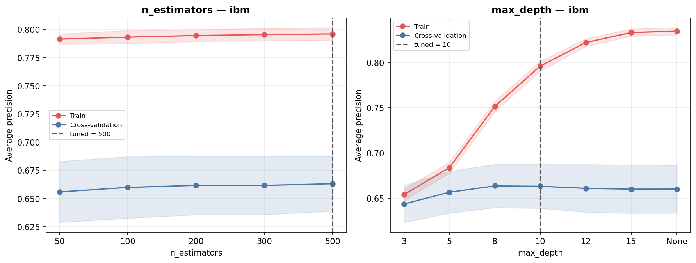
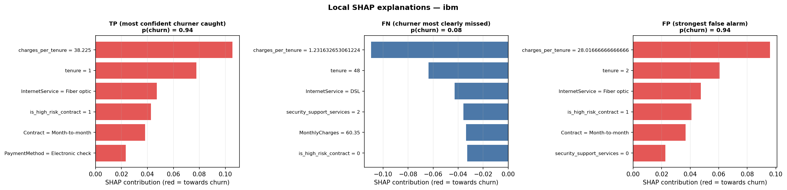

# 5.2. Phân tích Random Forest và ablation

> Bản nháp — Nam Khánh. Số liệu lấy từ `reports/results_snapshot.md` của lần chạy đầy đủ tại commit
> `89fa839` (§ = mục trong snapshot); sẽ cập nhật theo tag `v1.0-results`. Hình trong `figures/rf/`,
> notebook minh họa `notebooks/02_random_forest_analysis.ipynb`.

## 5.2.1. Cấu hình Random Forest sau khi tune

| Dataset | `n_estimators` | `max_depth` | `min_samples_leaf` | `max_features` |
|---|---:|---:|---:|---|
| IBM | 500 | 10 | 5 | `log2` |
| Iranian | 200 | không giới hạn | 1 | `log2` |
| Orange | 500 | không giới hạn | 2 | `sqrt` |

Tham số chọn bằng `RandomizedSearchCV` (30 tổ hợp, 5-fold CV trên tập train, tiêu chí AP; Iranian dùng fold
chia theo nhóm) và lưu ở `models/tuned_params.json`. `class_weight="balanced_subsample"` cố định (xem 5.2.7).

## 5.2.2. Random Forest so với mô hình mạnh nhất còn lại (10 lần chia dữ liệu)

Mỗi mô hình được huấn luyện lại trên 10 lần chia 70/15/15 với 10 seed khác nhau (tham số tune giữ cố định)
và đánh giá trên tập test (§7). Đối thủ mạnh nhất (AP trung bình cao nhất) hiện là Logistic Regression;
DT, KNN, SVM sẽ được bổ sung ở mục 5.1. p-value dùng kiểm định t có hiệu chỉnh của Nadeau và Bengio
(2003), phù hợp khi các tập train của 10 lần chia chồng lên nhau.

| Dataset | AP — RF | AP — LogReg | p (AP) | ROC-AUC — RF | ROC-AUC — LogReg | p (ROC-AUC) |
|---|---:|---:|---:|---:|---:|---:|
| IBM | 0.666 ± 0.020 | 0.668 ± 0.015 | 0.601 | 0.845 ± 0.009 | 0.846 ± 0.009 | 0.651 |
| Orange | 0.835 ± 0.047 | 0.465 ± 0.059 | < 0.001 | 0.909 ± 0.030 | 0.820 ± 0.028 | < 0.001 |
| Iranian | 0.912 ± 0.021 | 0.768 ± 0.029 | < 0.001 | 0.985 ± 0.003 | 0.938 ± 0.014 | < 0.001 |

- **IBM:** khả năng xếp hạng của RF và LogReg **ngang nhau** (chênh AP -0.003, p = 0.601; ROC-AUC p = 0.651). Ở ngưỡng 0.5, RF có F1 cao hơn (0.628 so với 0.578) nhờ recall cao hơn hẳn (0.732 so với 0.503) nhưng accuracy thấp hơn (0.770 so với 0.806; McNemar trên seed 42, p = 0.002). Chênh lệch này là của **điểm vận hành**, không phải của chất lượng mô hình: RF ở đây dùng `class_weight` và chưa calibrate, còn LogReg đã calibrate, nên ngưỡng 0.5 có ý nghĩa khác nhau với hai mô hình. Ngưỡng cuối cùng được chọn theo chi phí ở mục 5.3.
- **Orange và Iranian:** RF vượt trội cả về AP và ROC-AUC, thắng ở cả 10 lần chia trên mỗi bộ; p < 0.001 ngay cả với kiểm định đã hiệu chỉnh.

Kết luận: lợi thế của RF thể hiện rõ trên dữ liệu **hành vi định lượng** có quan hệ phi tuyến (số cuộc gọi
chăm sóc khách hàng, khiếu nại, tần suất sử dụng); trên dữ liệu chủ yếu là biến phân loại như IBM, mô hình
tuyến tính đã làm khá tốt. Các p-value chưa hiệu chỉnh cho việc so sánh nhiều lần; kết luận dựa trên hiệu
ứng lớn và nhất quán qua 10 lần chia.

## 5.2.3. Siêu tham số: validation curve

- **Số cây (`n_estimators`):** AP trên cross-validation tăng nhẹ rồi đi ngang (IBM: 0.656 với 50 cây, 0.662 với 200 cây, 0.663 với 500 cây). Thêm cây **không gây overfit**, chỉ tốn thời gian — đúng như lý thuyết ở mục 4.2.2.
- **Độ sâu (`max_depth`) trên IBM:** AP của CV gần như không đổi từ độ sâu 8 đến không giới hạn (0.664, 0.663, 0.661, 0.660, 0.660 lần lượt với độ sâu 8, 10, 12, 15, không giới hạn; chênh lệch 0.004, nhỏ hơn nhiều độ lệch giữa các fold ≈ 0.024), trong khi AP trên train tăng từ 0.751 lên 0.835. Cây sâu hơn chỉ học thuộc tập train mà không cải thiện CV; giá trị tune (10) nằm trong vùng phẳng này, nên không nên diễn giải là "độ sâu 10 tốt nhất". Độ sâu quá nhỏ thì kém rõ (0.644 với độ sâu 3).
- **Iranian và Orange** cần cây sâu: AP của CV tăng từ 0.860 (độ sâu 8) lên 0.891 (không giới hạn) trên Iranian và từ 0.808 lên 0.840 trên Orange, dù AP train gần 1.0. Các mẫu phi tuyến cần nhiều phép chia, và việc lấy trung bình nhiều cây giữ phương sai trong tầm kiểm soát — cũng là lý do RF mạnh hơn hẳn mô hình tuyến tính trên hai bộ dữ liệu này.

## 5.2.4. OOB, cross-validation và test

| Dataset | OOB AP | CV AP | Test AP (seed 42) | Trung bình 10 seed (§7) |
|---|---:|---:|---:|---:|
| IBM | 0.662 | 0.663 ± 0.024 | 0.665 | 0.666 ± 0.020 |
| Iranian | 0.889 | 0.891 ± 0.038 | 0.912 | 0.912 ± 0.021 |
| Orange | 0.847 | 0.840 ± 0.053 | 0.768 | 0.835 ± 0.047 |

CV dùng chính các fold đã chọn tham số nên hơi lạc quan; OOB tính trên cùng tập train đó nên cũng chia một phần sự lạc quan này. Chỉ tập test là độc lập với việc tune. Trên IBM và Iranian ba con số khớp nhau. Trên Orange, AP của tập test seed 42 (0.768) thấp hơn CV nhưng trung bình 10 seed lại khớp CV: tập test Orange chỉ có 500 dòng (khoảng 72 khách churn) nên một lần chia có thể "kém may". Đây là lý do nhóm báo cáo trung bình qua nhiều seed thay vì một con số. Với Iranian, OOB có thể lạc quan thêm vì một bản trùng có thể nằm trong mẫu bootstrap còn bản kia là OOB.

## 5.2.5. Đặc trưng nào quan trọng — ba cách đo cho ba câu chuyện

- **IBM — ba cách đo đồng thuận** (Spearman 0.84–0.96). Đứng đầu: chi phí trên mỗi tháng gắn bó (`charges_per_tenure`, hạng 1 theo MDI và SHAP; permutation chỉ xáo các cột gốc nên không đo đặc trưng này), rồi thời gian gắn bó (`tenure`), loại hợp đồng và dịch vụ Internet — ba biến này nằm trong top 5 của cả ba cách đo. Khớp với EDA: khách mới, hợp đồng theo tháng, dùng cáp quang và trả cước cao có nguy cơ rời bỏ cao nhất.
- **Iranian — MDI và permutation lệch nhau** (Spearman 0.31). `Complains` đứng đầu theo permutation (bỏ thông tin khiếu nại làm hiệu năng giảm nhiều nhất), `Status` đứng đầu theo MDI và SHAP. Nhóm đặc trưng sử dụng (`Frequency of use`, `Seconds of Use`, `Customer Value`) xếp cao theo MDI nhưng thấp theo permutation; `Customer Value` thậm chí âm (-0.014). Lý do: các đặc trưng này **tương quan mạnh** — xáo trộn một cột thì các cột còn lại bù thông tin.
- **Orange — ví dụ về thiên vị của MDI.** `Customer service calls` đứng đầu, tiếp theo là cước ban ngày và gói quốc tế. `State` (51 bang) xếp hạng 5 theo MDI và hạng 5 theo SHAP nhưng chỉ hạng 15 theo permutation (0.001): biến nhiều giá trị được MDI ưu ái (Strobl et al., 2007), và tổng |SHAP| của nhiều cột one-hot cộng dồn nhiễu. Không thể kết luận "bang cư trú quyết định churn".

**Bài học:** báo cáo nhiều cách đo; dùng permutation trên tập test để biết đặc trưng nào **ảnh hưởng hiệu
năng**, dùng SHAP để **giải thích dự đoán**; không cách nào là quan hệ nhân quả.

## 5.2.6. Giải thích từng khách hàng (SHAP cục bộ, IBM)

| Trường hợp | Điểm RF | Yếu tố chính (SHAP) |
|---|---:|---|
| **TP** — bắt đúng khách rời đi | 0.94 | Mới dùng 1 tháng, chi phí trên mỗi tháng gắn bó rất cao, cáp quang, hợp đồng theo tháng + Electronic check |
| **FN** — bỏ sót khách rời đi | 0.09 | Đã gắn bó 48 tháng, dùng DSL, hợp đồng 1 năm, có bảo mật và hỗ trợ kỹ thuật → hồ sơ "trung thành" |
| **FP** — báo nhầm | 0.94 | Mới dùng 2 tháng, cáp quang, hợp đồng theo tháng + Electronic check |

"Điểm RF" là điểm của rừng chưa calibrate (đại lượng mà SHAP phân rã); model deploy áp thêm một hàm sigmoid
đơn điệu nên thứ hạng rủi ro giữ nguyên. Ca FN cho thấy giới hạn của dữ liệu: khách trung thành vẫn có thể rời
đi vì lý do không có trong dữ liệu (chuyển nhà, đối thủ khuyến mãi, sự cố dịch vụ). Ca FP có hồ sơ rủi ro điển
hình; gửi ưu đãi cho nhóm này rẻ hơn nhiều so với mất khách, nên đây là loại báo nhầm chấp nhận được (phân tích
chi phí ở mục 5.3).

## 5.2.7. Ablation

**A1 — `TotalCharges`** (§3, §5): giữ cột này, ROC-AUC của RF trên IBM là 0.852 (bỏ: 0.851) và AP là 0.668 (bỏ: 0.665) → gần như không đổi, vì thông tin trùng với `tenure × MonthlyCharges`; giao thức chính bỏ cột này.

**A2 — xử lý mất cân bằng** (§6; RF đã tune, 5 seed, ngưỡng 0.5; mỗi biến thể chỉ đổi một yếu tố):

| Dataset | Biến thể | F1 | Recall | AP (test) | AP (validation) | ECE |
|---|---|---:|---:|---:|---:|---:|
| IBM | `class_weight` (mặc định) | 0.642 ± 0.017 | 0.751 | 0.677 ± 0.012 | 0.652 | 0.118 |
| IBM | không xử lý | 0.582 ± 0.017 | 0.509 | 0.677 ± 0.013 | 0.653 | 0.027 |
| IBM | SMOTE trong pipeline | 0.624 ± 0.016 | 0.639 | 0.662 ± 0.013 | 0.643 | 0.064 |
| Orange | `class_weight` (mặc định) | 0.728 ± 0.029 | 0.628 | 0.816 ± 0.042 | 0.829 | 0.092 |
| Orange | không xử lý | 0.687 ± 0.054 | 0.544 | 0.829 ± 0.043 | 0.850 | 0.069 |
| Orange | SMOTE trong pipeline | 0.749 ± 0.064 | 0.694 | 0.792 ± 0.060 | 0.795 | 0.095 |
| Iranian | `class_weight` (mặc định) | 0.827 ± 0.026 | 0.808 | 0.882 ± 0.023 | 0.928 | 0.041 |
| Iranian | không xử lý | 0.835 ± 0.022 | 0.819 | 0.925 ± 0.023 | 0.947 | 0.033 |
| Iranian | SMOTE trong pipeline | 0.856 ± 0.026 | 0.886 | 0.898 ± 0.027 | 0.932 | 0.043 |

Với rừng đã tune, `class_weight` **không** làm mô hình xếp hạng tốt hơn: AP trên IBM như nhau (0.677 so với 0.677), trên Orange và Iranian còn thấp hơn (0.816 so với 0.829; 0.882 so với 0.925), và AP trên validation cho cùng kết luận. Tác dụng chính của nó là dời điểm vận hành ở ngưỡng 0.5 (IBM: recall 0.751 so với 0.509) và làm lệch xác suất (ECE 0.118 so với 0.027). So với không xử lý mất cân bằng, SMOTE tăng recall ở ngưỡng 0.5 (IBM 0.639 so với 0.509) nhưng **giảm AP** trên cả ba dataset (0.662 so với 0.677; 0.792 so với 0.829; 0.898 so với 0.925), tức nó dịch điểm vận hành chứ không làm mô hình xếp hạng tốt hơn, lại thêm độ phức tạp và rủi ro rò rỉ. Vì ngưỡng cuối cùng được chọn theo chi phí sau khi calibrate (mục 5.3), lợi ích ở ngưỡng 0.5 của cả hai cách đều không còn ý nghĩa.

> **Đề xuất (chờ nhóm quyết định trước 06/12):** đưa `class_weight ∈ {balanced_subsample, None}` vào lưới
> tune của RF thay vì cố định. Việc này cần chạy lại toàn bộ thí nghiệm và cập nhật số liệu.

**A3 — chuẩn hóa** (§6): F1 và AP khác nhau không quá 0.0012 trên cả ba dataset, nhỏ hơn nhiều so với độ dao động giữa các seed → xác nhận cây quyết định không bị ảnh hưởng bởi chuẩn hóa; chênh lệch nhỏ đến từ sai số làm tròn khi chọn ngưỡng chia.

## 5.2.8. Calibration của model deploy

| Phương án (IBM) | AP (test) | Brier | ECE | Xác suất TB | AP (validation) | Dung lượng |
|---|---:|---:|---:|---:|---:|---:|
| RF chưa calibrate | 0.665 | 0.152 | 0.121 | 0.386 | 0.6275 | 17.0 MB |
| RF + sigmoid, 5 rừng (`ensemble=True`) | 0.663 | 0.135 | 0.028 | 0.269 | 0.6281 | 73.9 MB |
| **RF + sigmoid, 1 rừng (`ensemble=False`) — deploy** | 0.665 | 0.135 | 0.029 | 0.272 | 0.6275 | 16.9 MB |
| RF + isotonic, 5 rừng | 0.661 | 0.134 | 0.026 | 0.268 | 0.6279 | 73.9 MB |
| LogReg (tham chiếu) | 0.672 | 0.133 | 0.015 | 0.270 | 0.6389 | < 0.1 MB |

Tỉ lệ churn thật của tập test là 0.265. RF chưa calibrate dự đoán trung bình 0.386 — lệch lên do `class_weight` — với ECE 0.121. Calibration đưa ECE xuống 0.029 mà không đổi thứ hạng (AP giữ nguyên 0.665, vì sigmoid là hàm đơn điệu). Lựa chọn phương án đọc trên **validation**: một rừng cho AP 0.6275 so với 0.6281 của 5 rừng và Brier 0.1383 so với 0.1381, tức tương đương, nhưng file chỉ 16.9 MB so với 73.9 MB (6.6 MB khi nén). Model deploy cuối cùng giảm từ 91 MB xuống 17 MB. Trên test, isotonic có ECE thấp hơn một chút (0.026 so với 0.029), nhưng trên validation, nơi đọc lựa chọn, isotonic lại kém hơn (Brier 0.1390 so với 0.1383, ECE 0.031 so với 0.024) và cũng cần 5 rừng (73.9 MB). Nhóm giữ Platt scaling vì chỉ có 2 tham số, ổn định hơn khi dữ liệu không lớn.

## 5.2.9. Tóm tắt

1. RF là lựa chọn đúng cho dữ liệu hành vi có quan hệ phi tuyến (Orange, Iranian): vượt LogReg rất xa cả về
   AP và ROC-AUC, nhất quán qua 10 lần chia và có ý nghĩa thống kê theo kiểm định đã hiệu chỉnh.
2. Trên IBM, RF ngang LogReg về khả năng xếp hạng; khác biệt ở ngưỡng 0.5 là của điểm vận hành.
3. Thêm cây không gây overfit; trên IBM độ sâu từ 8 trở lên cho CV như nhau, trên Iranian/Orange cần cây sâu.
4. Giải thích của mô hình khớp hiểu biết nghiệp vụ; cần nhiều cách đo độ quan trọng khi có đặc trưng tương
   quan hoặc nhiều giá trị.
5. `class_weight` và SMOTE không cải thiện xếp hạng; calibration là bắt buộc trước khi chọn ngưỡng theo chi
   phí, và phương án một rừng vừa tốt vừa gọn.
